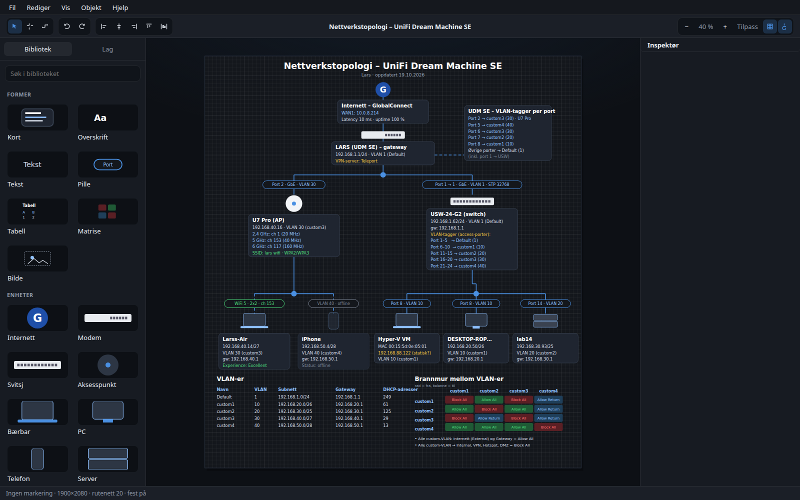
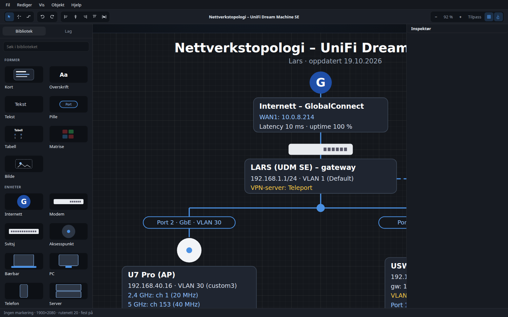
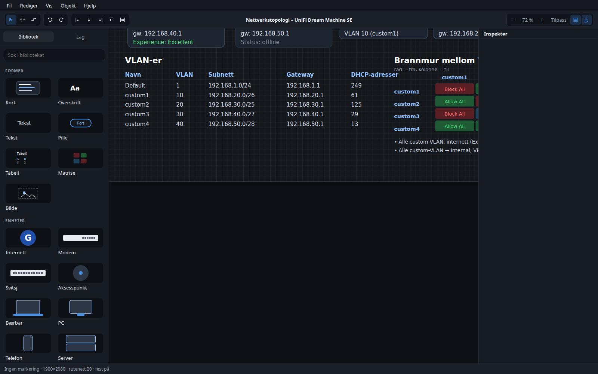
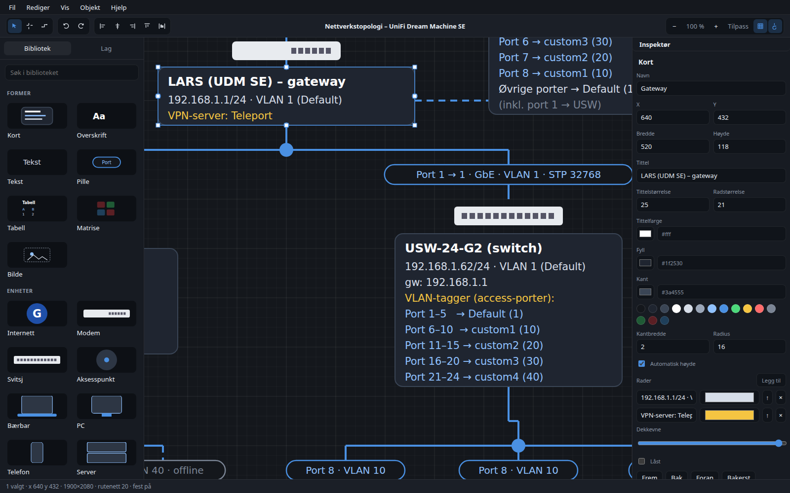
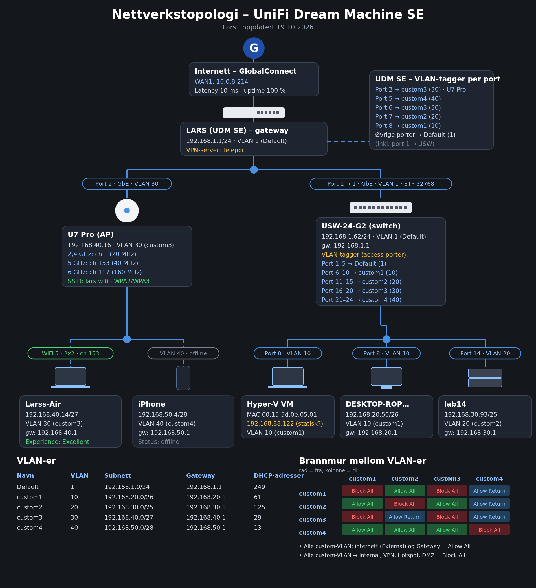

# Topologi Studio

Topologi Studio er et macOS-program for å tegne nettverkstopologi. Det er laget med Tauri 2 og en TypeScript-frontend som tegner på et SVG-lerret. Standardutseendet er mørkt, og den innebygde malen gjenskaper skissen «Nettverkstopologi – UniFi Dream Machine SE».

Grensesnittet er på norsk bokmål.



## Installere

Versjon 0.1.0 er usignert. Last ned universal-diskfilen fra [GitHub-utgivelsen v0.1.0](https://github.com/xdkurbie/topologi-studio/releases/tag/v0.1.0).

1. Åpne `Topologi Studio_0.1.0_universal.dmg`.
2. Dra **Topologi Studio** til Programmer.
3. Første gang må du høyreklikke appen og velge **Åpne**, og deretter bekrefte. Et vanlig dobbeltklikk blir stoppet av Gatekeeper.
4. Hvis macOS fortsatt avviser appen, fjern karantenen:

```bash
xattr -dr com.apple.quarantine "/Applications/Topologi Studio.app"
```

Appen kjører på Apple Silicon og Intel (macOS 11 eller nyere).

## Slik ser malen ut

Øverste del av UniFi-malen, med gateway, ONT og VLAN-tagger:



VLAN-tabell og brannmurmatrise:



Inspektøren for et valgt kort:



Eksportert PNG av malen, 1×:



## Bruke programmet

Biblioteket til venstre har kort, tekst, piller, tabell, matrise, bilde og enhetsikoner. Klikk eller dra et element inn på arket. Koblinger tegnes ved å klikke to porter, eller ved å dra fra en port til en annen. En kobling blir hengende på elementet når det flyttes. Slettes elementet, fryses endepunktet der det sto.

Inspektøren til høyre endrer tekst, skrift, farger, radius og linjestil. Matriseceller veksler mellom Allow All, Block All og Allow Return. Lag-fanen viser rekkefølgen. Rutenett, festing og justeringshjelpelinjer kan slås av. Hold Alt nede mens du drar for å slippe festingen.

Filer lagres som `.topo` (JSON, format `topologi-studio`, versjon 1). Bilder du tar inn, ligger inne i filen. Programmet husker nylige filer og autolagrer til én gjenopprettingsplass. Eksporter PNG (1×, 2× eller 3×), SVG eller PDF. I nettleseren under utvikling lastes filer ned. I appen brukes macOS sine filvinduer.

Menylinjen i appen er den vanlige macOS-linjen. Når du kjører frontend alene, ligger de samme menyene inne i vinduet.

## Tastatursnarveier

| Taster | Handling |
| --- | --- |
| V, H, K | Velg, hånd, kobling |
| Mellomrom og dra | Panorer |
| Rullehjul | Panorer |
| Klyp, eller Cmd og rull | Zoom mot pekeren |
| Cmd +, Cmd −, Cmd 0, Cmd 1 | Zoom inn, ut, 100 %, tilpass |
| Shift-klikk | Legg til i markeringen |
| Dra på tomt område | Marker flere |
| Piltaster | Flytt 1 px, Shift flytter 10 px |
| Cmd Z, Cmd Shift Z | Angre, gjør om |
| Cmd C, X, V, D | Kopier, klipp ut, lim inn, dupliser |
| Delete | Slett |
| Cmd A | Merk alt |
| Cmd ] og Cmd [ | Flytt foran eller bak |
| Cmd S, Cmd Shift S, Cmd O, Cmd N | Lagre, lagre som, åpne, ny |
| Cmd Shift E | Eksporter PNG |
| Dobbeltklikk | Rediger tekst |
| Alt-klikk i en matrise | Bytt Allow / Block / Return |
| Escape | Avbryt kobling eller markering |

## Inspirasjon

Ideene under er bare arbeidsmønstre. Koden, ikonene og grafikken i Topologi Studio er laget for dette programmet og er ikke kopiert fra prosjektene.

| Prosjekt | Mønster som er brukt som idé |
| --- | --- |
| [draw.io](https://github.com/jgraph/drawio) (Apache-2.0) | Formbibliotek, porter, ortogonal koblingsruting og inspektør |
| [Excalidraw](https://github.com/excalidraw/excalidraw) | Angre og gjør om via øyeblikksbilder av dokumentet |
| [tldraw](https://github.com/tldraw/tldraw) | Justeringshjelpelinjer, panorering og zoom |
| [React Flow / xyflow](https://github.com/xyflow/xyflow) | Koblinger som blir hengende på nodene når de flyttes |
| [JointJS](https://github.com/clientIO/joint) og [maxGraph](https://github.com/maxGraph/maxGraph) | Festing til porter og Visio-lignende nettverksdiagram |

Avhengigheter hentes inn via npm og Cargo. Skriften på lerretet er DejaVu Sans, som følger med under sin egen lisens i `src/assets/fonts/LICENSE`.

## Begrensninger

- Appen er ikke signert eller notarisert.
- PDF-eksporten er et bilde i en PDF. Teksten kan ikke merkes.
- Ortogonal ruting knekker i rett vinkel og går ikke rundt andre elementer.
- Autolagring har én plass, ikke en historikk.
- Universal-bygget lages på GitHub Actions. Denne maskinen kan ikke pakke en macOS-diskfil lokalt.

## Utvikling

```bash
npm install
npm test
npm run dev
```

Frontend kjører på `http://127.0.0.1:1420`. `?doc=unifi` åpner malen direkte. Appen bygges med `npm run tauri build -- --target universal-apple-darwin` på en Mac. Utgivelsen v0.1.0 lages av `.github/workflows/release.yml` når `main` oppdateres.
